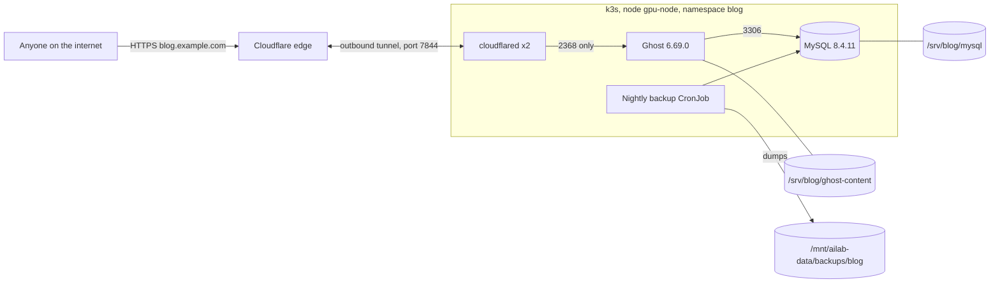

# Public blog: Ghost at blog.example.com

Ghost (the open-source Medium alternative) runs on the lab k3s cluster in namespace `blog`, with
its own MySQL. A Cloudflare Tunnel publishes it at **https://blog.example.com**. The tunnel is
outbound only: no router ports are opened, and the connector can reach only the Ghost Service,
so the rest of the lab stays private.

Status: **staging test passed on the lab 2026-10-10 (blog-staging, then removed); Prod not deployed.** No Cloudflare tunnel or DNS record exists
yet. Prod deploy needs the operator's approval.

## Architecture



## Versions (pinned, checked 2026-10-10 on Docker Hub)

| Component | Image |
|---|---|
| Ghost | `docker.io/library/ghost:6.69.0-alpine` |
| MySQL | `docker.io/library/mysql:8.4.11` (8.4 LTS; Ghost supports MySQL 8 only) |
| cloudflared | `docker.io/cloudflare/cloudflared:2026.10.0` |

## Files

| Path | What |
|---|---|
| `k8s/blog/base/` | Ghost, MySQL, NetworkPolicies, backup CronJob (no namespace) |
| `k8s/blog/prod/` | Namespace `blog`, URL `https://blog.example.com`, cloudflared, backup PV on the data lake |
| `k8s/blog/staging/` | Namespace `blog-staging`, no tunnel, own image `/srv/blog-staging` |
| `scripts/blog/secrets.sh` | Creates Secrets out of band (nothing secret is in git) |
| `scripts/blog/brand.sh` | Applies example branding through the Ghost Admin API |
| `assets/blog-brand/` | example brand assets (logo lockups, Si tile icon, favicon, cover) |
| `infra/blog/storage-setup.sh` | Creates and mounts the blog's ext4 image on the data lake (prod or staging) |
| `k8s/blog/storageclass.yaml` | `blog-static` class for the static PVs |
| `scripts/blog/restore.sh` | Restores DB and content from the backup files |
| `scripts/blog/restore-test.sh` | Staging drill: deploy, post, back up, wipe everything, restore, check |
| `scripts/blog/staging-test.sh` | Deploys staging, smoke-tests over port-forward, runs a backup, tears down |

## Storage

Stateless rule: no blog data under `/var/lib/rancher` (no `local-path`). Everything lives in
dedicated folders on the data lake, so the blog restores on any device that has the lake.

- **MySQL and Ghost content:** one ext4 image file, `/mnt/ailab-data/blog/blog-store.ext4`
  (10G, resize later if needed), loop-mounted at `/srv/blog` (`noatime,nodiscard`) by a systemd mount unit that starts
  before k3s, the same pattern as observability and Forgejo. Static local PVs (Retain, pinned to
  `gpu-node`): `/srv/blog/mysql`, `/srv/blog/ghost-content`. ext4 is needed because MySQL needs Unix
  owners and modes, which exFAT lacks.
- **Growing the image later:** ext4 grows online, no downtime. Replace `15G` with the new size:
  ```bash
  sudo truncate -s 15G /mnt/ailab-data/blog/blog-store.ext4
  sudo losetup -c "$(findmnt -no SOURCE /srv/blog)"
  sudo resize2fs "$(findmnt -no SOURCE /srv/blog)"
  df -h /srv/blog
  ```
  Then raise the two PV/PVC sizes in `k8s/blog/prod/storage.yaml` to match (they are labels
  on local volumes, not hard limits).
- **Backups:** nightly at 03:15 Central, 14 days kept, plain `.gz` files on exFAT at
  `/mnt/ailab-data/backups/blog/{db,content}/`.
- **Staging** uses its own 2G image `/mnt/ailab-data/blog-staging/blog-staging-store.ext4` at
  `/srv/blog-staging` and backups in `/mnt/ailab-data/backups/blog-staging`.
- Config is in Git; Secrets come from `scripts/blog/secrets.sh` and are never in the repo.

## Security

- Default-deny NetworkPolicies, in and out. Ghost accepts traffic on 2368 only from cloudflared.
  MySQL accepts traffic only from Ghost and the backup job. cloudflared can reach only Ghost and
  Cloudflare (public 7844 and 443). Ghost egress: DNS, MySQL, and public 443, 465, and 587 (themes,
  Gravatar, newsletter mail); no LAN, tailnet, or cluster ranges.
- Non-root pods, all capabilities dropped, no privilege escalation, RuntimeDefault seccomp, no
  ServiceAccount tokens, resource limits on every container.
- Secrets: `blog-mysql` (`root-password`, `password`, generated) and `blog-cloudflared`
  (`token`, pasted by the operator, input hidden). Never printed or committed.
- **Recommended:** protect the admin area with Cloudflare Access (free for up to 50 users) so
  `blog.example.com/ghost` asks for the operator's email login before Ghost's own sign-in. Step 4 below.

## Branding

`scripts/blog/brand.sh` signs in as the owner and sets:

- Accent color **#2F5BFF** (example Blue): links, buttons, and the Subscribe button.
- Logo: `example-si-tile-lockup-light.png`. The Si tile is always shown with the wordmark; the
  tile alone is used only as the browser icon (`example-si-tile-icon-512.png`; Ghost builds the
  favicon from it).
- Cover: `example-blog-cover-2000x666-plain.png` (text-free version from the example brand assets: slate with the blue
  glow). The site description ("adapt adopt advance. Private super intelligence you own.") is
  the single hero headline; the original cover with the wordmark and tagline baked in is kept
  in `assets/blog-brand/` for other uses. Title `example`.
- Site-wide code injection: Sora SemiBold for headings, Inter for body text, JetBrains Mono for
  code (Google Fonts), plus Paper, Ink, and Line colors from the kit.


## Staging test

On the lab host, from the repo:

```bash
sudo bash scripts/blog/staging-test.sh          # deploy, test, tear down
sudo KEEP=1 bash scripts/blog/staging-test.sh   # leave blog-staging running to look at it
```

Pass means: MySQL and Ghost roll out, `GET /` and `GET /ghost/api/admin/site/` return HTTP 200
through `kubectl port-forward`, a throwaway staging owner is created and the branding is
applied and found on the home page, and a manual backup Job finishes and lists both files.

## Prod deploy (after approval)

1. **Create the tunnel (the operator, Cloudflare dashboard).**
   1. Cloudflare dashboard, **Zero Trust**, **Networks**, **Tunnels**, **Create a tunnel**.
   2. Type **Cloudflared**, name `blog`, **Save tunnel**.
   3. On the install page choose **Docker**, and copy only the token (the long string after
      `--token`). Do not run the command shown; the cluster runs the connector.
   4. **Next**, add a **Public hostname**: subdomain `blog`, domain `example.com`, path empty,
      service type **HTTP**, URL `ghost:2368`. **Save tunnel**. Cloudflare creates the proxied
      DNS record `blog.example.com` itself.
2. **Deploy (lab host, from the repo on `main` after the PR merges).**
   ```bash
   cd /mnt/ailab-data/ssi-platform && git pull
   sudo bash infra/blog/storage-setup.sh          # image + mount unit at /srv/blog
   sudo k3s kubectl apply -f k8s/blog/storageclass.yaml
   sudo NS=blog bash scripts/blog/secrets.sh        # paste the token when asked
   sudo k3s kubectl apply -k k8s/blog/prod
   sudo k3s kubectl -n blog rollout status deploy/ghost --timeout=600s
   sudo k3s kubectl -n blog get pods
   ```
   The tunnel shows **Healthy** in the dashboard once cloudflared connects.
3. **Claim the admin account at once.** Open `https://blog.example.com/ghost` and create the owner
   account. Until this is done, anyone who opens that page first could claim it, so do it
   right after step 2 (or do step 4 before step 2).
4. **Lock the admin area (recommended).** Zero Trust, **Access**, **Applications**, **Add an
   application**, **Self-hosted**: domain `blog.example.com`, path `ghost`. Policy: Allow, Include,
   Emails, the operator's email. Readers are unaffected; only `/ghost` is gated.
5. **Apply branding.** After setting up mail (step 6; Ghost 6 emails a code to verify each new
   sign-in device, and without mail a scripted sign-in is refused), run from the operator's machine or
   the lab with the owner login in env vars, not on the command line:
   ```bash
   read -rp 'Owner email: ' GHOST_EMAIL; read -rsp 'Password: ' GHOST_PASSWORD; echo
   GHOST_URL=https://blog.example.com GHOST_EMAIL=$GHOST_EMAIL GHOST_PASSWORD=$GHOST_PASSWORD \
     bash scripts/blog/brand.sh
   ```
   Or set the same items by hand in **Settings, Design and branding** and **Code injection**
   (paste the head block from `brand.sh`).
6. **Check.** `curl -sI https://blog.example.com | head -1` returns `HTTP/2 200`. Test a backup:
   ```bash
   sudo k3s kubectl -n blog create job --from=cronjob/blog-backup blog-backup-now
   sudo k3s kubectl -n blog logs -f job/blog-backup-now
   ```
7. **Mail.** Needed for device verification, newsletters, and staff invites: add SMTP settings (for example
   Mailgun) as env vars `mail__transport=SMTP`, `mail__options__host`, and so on, with the
   password in a Secret.

## Restore

On `gpu-node` or any replacement node with the data lake mounted, from the repo:
```bash
sudo bash infra/blog/storage-setup.sh                 # skip if the image is intact
sudo k3s kubectl apply -f k8s/blog/storageclass.yaml
sudo NS=blog bash scripts/blog/secrets.sh
sudo k3s kubectl apply -k k8s/blog/prod
sudo NS=blog bash scripts/blog/restore.sh             # latest backup; or TS=YYYYMMDD-HHMM
```
If the image file survived, steps 1 to 4 alone bring the blog back with its data; `restore.sh`
is for a lost or damaged image. It loads the SQL dump into MySQL, replaces
`/srv/blog/ghost-content` with the content tarball, and restarts Ghost.

**Tested drill:** `sudo bash scripts/blog/restore-test.sh` deploys staging, publishes a post,
backs up, deletes the namespace, PVs and the staging image, rebuilds it empty (post returns 404),
restores, checks the post returns 200 with its text, then tears staging down.

## Remove

```bash
sudo k3s kubectl delete -k k8s/blog/prod     # the backup PV is Retain; dumps stay on the lake
```
Then delete the `blog` tunnel in Zero Trust (its DNS record goes with it).
