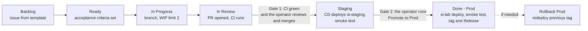

# SI delivery: Kanban SDLC with short releases to Prod

Every change to the SSI platform travels one path: a card on the **SSI Delivery** board, a
branch, a pull request with CI, a human review, an automatic staging deploy with a smoke test,
a human promotion to Prod, a tagged GitHub Release, and a one-click rollback. Releases are
small and frequent; a card should go from Ready to Prod in hours, not weeks.

## Flow



| Column | Enters when | Who or what moves it |
|---|---|---|
| Backlog | Issue created from the feature or bug template | the operator |
| Ready | Acceptance criteria are written | the operator |
| In Progress | Work starts on a branch (WIP limit 2) | the operator or the SI agent |
| In Review | A PR with `Card: #N` is opened | `Board sync` workflow |
| Staging | The merge deployed to si-staging and passed the smoke test | `CD Staging` workflow |
| Done (Prod) | Promotion deployed to si-lab, passed the smoke test, and was released | `Promote to Prod` workflow |

## The two human gates, and why they look like this

The repo is private on the GitHub Free plan. Checked through the API on 2026-10-10:

- Branch protection and rulesets return *"Upgrade to GitHub Pro or make this repository
  public"*, so "PR required" and "required status check" cannot be enforced by GitHub.
- Environments work, but required reviewers return *"Please ensure the billing plan supports
  the required reviewers protection rule"*.
- GitHub never lets an author approve their own PR, and the operator is the only human on the repo,
  so "1 approval" could not work even on a paid plan without a second account.

So the gates are built into the pipeline, where they hold on the Free plan:

1. **Gate 1, merge.** CI (`.github/workflows/ci.yml`) runs every test suite and the
   manifest-in-sync check on each PR. the operator reviews the PR against the reviewer checklist and
   merges it himself; he is the only account with write access. `CD Staging` runs CI again on
   the merged commit and deploys only if it passes, so red code never reaches staging even if
   a PR is merged red.
2. **Gate 2, Prod.** `Promote to Prod` is a manual `workflow_dispatch`. It refuses to run
   unless the actor is the repo owner, the input says `PROMOTE`, the commit is on `main`, and
   that exact commit has a successful `CD Staging` run. Nothing else deploys to si-lab.

On GitHub Pro or Team, add the `prod` environment's required reviewer and a `main` ruleset
requiring the `CI` check; the workflows already use the `staging` and `prod` environments, so
nothing else changes.

## Environments

| | Staging | Prod |
|---|---|---|
| Namespace | `si-staging` | `si-lab` |
| Runs | m365-mcp, control-layer, ssi-langgraph | the full lab |
| Ollama | shared from si-lab by service DNS | own |
| Prompt Guard | shared from si-lab (needs `k8s/sdlc/10-si-lab-allow-staging.yaml`) | own |
| Microsoft 365 | no sign-in Secret, so tools answer "Not signed in" (no personal data) | the operator's sign-in |
| Memory (pgvector) | off (no `pgvector-auth`) | on |
| engineering-mcp, mcp-server | si-lab by FQDN; their ingress policies keep staging out | own |

`scripts/sdlc/render.py` turns the generated lab manifests into each stage's objects and stamps
the commit SHA on every pod template (`si.sdlc/git-sha`), so the smoke test can prove which
commit is running.

## Runners and credentials

Staging and Prod are separated at three levels: runner, Linux user, and Kubernetes account.

| | Staging | Prod |
|---|---|---|
| Runner | `si-lab-staging-runner`, labels `self-hosted`, `si-lab-staging` | `si-lab-runner`, labels `self-hosted`, `si-lab` |
| systemd service | `actions.runner.MCS-BG-ssi-platform.si-lab-staging-runner` | `actions.runner.MCS-BG-ssi-platform.si-lab-runner` |
| Install folder (mode 700) | `/opt/actions-runner-staging` | `/opt/actions-runner` |
| Linux user (no sudo) | `ghrunner-staging`, home mode 700 | `ghrunner`, home mode 700 |
| kubeconfig (mode 600) | `/home/ghrunner-staging/.kube/config` | `/home/ghrunner/.kube/config` |
| Kubernetes account | `si-staging/sdlc-staging-deployer` (`k8s/sdlc/00-si-staging-and-staging-deployer.yaml`) | `si-lab/sdlc-deployer` (`k8s/sdlc/01-si-lab-deployer.yaml`) |
| Rights | si-staging only | si-lab only |
| Jobs | `CD Staging` deploy (`runs-on: [self-hosted, si-lab-staging]`) | `Promote to Prod` and `Rollback Prod` deploy (`runs-on: [self-hosted, si-lab]`) |

Staging names always say staging; Prod names are neutral.

- Each account can apply ConfigMaps, Services, Deployments, and NetworkPolicies and read pods,
  logs, and events in its own namespace. Neither can exec into or port-forward to pods, read
  Secrets, or delete anything, and neither has rights in the other namespace.
- A job lands only on a runner that has every label it asks for. Staging jobs need
  `si-lab-staging`, which the Prod runner lacks; Prod jobs need `si-lab`, which the staging
  runner lacks. CI
  runs on GitHub-hosted `ubuntu-latest`.
- Neither Linux user can read the other's home, so a staging job cannot pick up the Prod
  credentials.
- Smoke tests run over the network: the lab host calls each Service's ClusterIP (`/healthz`,
  then `/ask`), and `kubectl get` proves every Deployment template and running pod carries the
  release's `si.sdlc/git-sha`. No exec into Prod pods.

## Workflows

| Workflow | Trigger | Does |
|---|---|---|
| `CI` | every PR, called by CD | tests for ssi-langgraph, m365-mcp, engineering-mcp, and control-layer, plus `build_manifest --check` and render checks |
| `CD Staging` | push to `main` | CI, deploy si-staging, smoke test, cards to Staging |
| `Promote to Prod` | manual, owner only | gate checks, deploy si-lab, smoke test, tag `vYYYY.MM.DD-N`, Release with generated notes, cards to Done (Prod) |
| `Rollback Prod` | manual, owner only | redeploy a release tag to si-lab, smoke test |
| `Board sync` | PR opened, called by CD and Promote | moves `Card: #N` issues on the board, sets `stage/*` labels |

The board moves need the `PROJECT_TOKEN` repo secret (a classic token with `project` and
`repo` scopes), because the built-in Actions token cannot write user-owned Projects. Without it,
the `stage/*` labels still track every card.

## Demo script: issue to Prod in about 15 minutes

1. **Board.** Open SSI Delivery. Point out the columns, the WIP limit of 2, and one card in
   Ready, for example "Calendar answers must not guess when Outlook fails".
2. **Build.** Move it to In Progress. Show the branch and the failing-then-passing test.
3. **PR.** Open the PR with `Card: #N`. The card jumps to In Review; CI starts. Walk the
   reviewer checklist while CI runs (about 2 minutes).
4. **Gate 1.** CI is green. Review the diff and merge. Explain why the gate is the merge plus
   CI re-run on the merged commit (Free plan, single maintainer).
5. **Staging.** Show `CD Staging`: deploy to si-staging on the lab runner, the smoke test
   proving the new SHA is running, and the card in Staging.
6. **Gate 2.** Run `Promote to Prod` with the SHA and `PROMOTE`. Show the gate step checking
   owner, main, and staging success.
7. **Prod.** Watch the si-lab deploy, the smoke test, and the Release `vYYYY.MM.DD-N` with
   generated notes. The card lands in Done (Prod) and the issue closes.
8. **Rollback.** Show `Rollback Prod` with the previous tag (run it only if time allows).

## One-time setup (done once per repo)

```bash
sudo k3s kubectl apply -f k8s/sdlc/00-si-staging-and-staging-deployer.yaml   # staging namespace, RBAC
sudo k3s kubectl apply -f k8s/sdlc/01-si-lab-deployer.yaml                   # Prod deploy identity
sudo k3s kubectl apply -f k8s/sdlc/10-si-lab-allow-staging.yaml      # staging -> Prompt Guard
gh auth refresh -h github.com -s project                             # create the board
gh secret set PROJECT_TOKEN -R MCS-BG/ssi-platform                 # board moves from Actions
```

